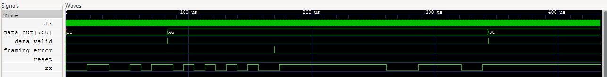
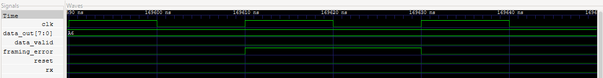

# fpga-uart

A UART (Universal Asynchronous Receiver/Transmitter) implementation written in SystemVerilog, with Python/cocotb testbenches and automated GitHub Actions testing.

The project includes separate transmitter (TX) and receiver (RX) modules, plus a loopback wrapper that connects them together. Development and verification use simulation; physical FPGA hardware is not required.

## Project Objectives

- Design UART transmitter and receiver modules in SystemVerilog.
- Implement finite-state machines (FSMs), baud-rate timing, and serial data handling.
- Develop Python-based testbenches to generate test sequences and verify transmitted and received data.
- Validate functionality through simulation, waveform analysis, and automated testing.
- Integrate GitHub Actions for continuous integration (CI).

## Technical Specifications

| Parameter | Initial Configuration |
|---|---|
| Hardware Description Language | SystemVerilog |
| Data Bits | 8 |
| Parity | None |
| Stop Bits | 1 |
| Bit Order | Least significant bit first |
| Clock Frequency | 50 MHz in the testbenches |
| Clocks per Bit | 434 by default |
| Baud Rate | Approximately 115,207 bps, targeting 115200 |
| Reset | Active-high, synchronous |
| Hardware Target | Simulation-first, FPGA-oriented |

## Repository Structure

| File | Purpose |
|---|---|
| `rtl/uart_tx.sv` | UART transmitter |
| `rtl/uart_rx.sv` | UART receiver |
| `rtl/uart_loopback.sv` | Connects TX directly to RX |
| `tests/test_uart_tx.py` | Independent transmitter tests |
| `tests/test_uart_rx.py` | Independent receiver tests |
| `tests/test_uart_loopback.py` | Tests TX and RX together |
| `docs/images/` | GTKWave screenshots of normal reception and framing-error recovery |
| `Makefile` | Selects and runs simulation targets |
| `.github/workflows/uart-tests.yml` | Runs all three targets in GitHub Actions |

## Development Tools

| Tool | Purpose |
|---|---|
| Icarus Verilog | SystemVerilog simulation through cocotb |
| Python/cocotb | Test generation and automated verification |
| GNU Make | Build and run simulations |
| MSYS2 UCRT64 | Local Windows development environment |
| GitHub Actions | Automated testing on pushes and pull requests |
| GTKWave | Digital waveform visualization |

## Installation

### Windows: MSYS2 UCRT64

1. Download and install [MSYS2](https://www.msys2.org/).

2. Open **MSYS2 UCRT64** from the Windows Start menu. Run all commands below in that terminal.

3. Update MSYS2:

```bash
pacman -Syu
```

If prompted to close the terminal, allow it to close, reopen **MSYS2 UCRT64**, and run the command again to finish updating.

4. Install Git, GNU Make, Icarus Verilog, Python, pip, and the compiler:

```bash
pacman -S --needed git make \
    mingw-w64-ucrt-x86_64-iverilog \
    mingw-w64-ucrt-x86_64-python \
    mingw-w64-ucrt-x86_64-python-pip \
    mingw-w64-ucrt-x86_64-gcc
```

Accept the installation prompts. The compiler is available if Python packages need to build from source.

For waveform inspection, optionally install GTKWave:

```bash
pacman -S --needed mingw-w64-ucrt-x86_64-gtkwave
```

5. Create and activate a Python virtual environment:

```bash
python -m venv ~/uart-venv
source ~/uart-venv/bin/activate
```

6. Install cocotb inside the virtual environment:

```bash
python -m pip install "cocotb>=2.0,<3.0"
```

7. Clone the repository:

```bash
git clone https://github.com/groundctrl2/fpga-uart.git
cd fpga-uart
```

The repository is created inside the terminal’s current directory. To choose another location, change directories before cloning.

8. Check that the tools are available:

```bash
python --version
make --version
iverilog -V
cocotb-config --version
```

9. Run the default TX tests:

```bash
make
```

See **Running Tests** below for RX and loopback commands.

### Returning to the Project

Whenever you open a new UCRT64 terminal, activate the virtual environment again:

```bash
source ~/uart-venv/bin/activate
```

Then change to your repository directory and run the desired test command.

You only need to create the environment and install cocotb once. GTKWave is optional for running tests and is used separately for waveform inspection.

## Running Tests

Run these commands from the repository root. On Windows, use the configured MSYS2 UCRT64 shell.

```bash
# Test TX (the default target).
make

# Test TX explicitly.
make TARGET=uart_tx

# Test RX.
make TARGET=uart_rx

# Test TX and RX together.
make TARGET=uart_loopback
```

Each target uses a separate simulation build directory. The test output reports individual test results and an overall pass/fail summary.

GitHub Actions also runs all three targets on pushes and pull requests, using Ubuntu 24.04 and Python 3.12.

## Waveform Inspection

### ASCII A Loopback

Generate a waveform for the ASCII `A` loopback test:

```bash
make TARGET=uart_loopback WAVES=1 COCOTB_TEST_FILTER=loopback_ascii_a
```

Open the generated waveform in GTKWave:

```bash
gtkwave sim_build_uart_loopback/uart_loopback.fst
```

Waveform inspection confirmed:

- The frame contains a low start bit, eight data bits sent LSB first, and a high stop bit.
- Transmitted and received data match ASCII `A` (`0x41`).
- Each bit lasts 8.68 μs (434 clock cycles at 50 MHz).
- `busy` returns low after transmission.
- `data_valid` pulses for one clock cycle (20 ns).
- `framing_error` remains low.

#### Full Frame


#### Data Valid Pulse


### RX Framing Error and Recovery

Generate and open the framing-error test waveform:

```bash
make TARGET=uart_rx WAVES=1 COCOTB_TEST_FILTER=framing_error_and_recovery
gtkwave sim_build_uart_rx/uart_rx.fst
```

#### Full Sequence

The receiver accepts `0xA6`, rejects `0x55` because its stop bit is low, and then successfully receives `0x3C`. During the rejected frame, `data_out` remains `0xA6` and no `data_valid` pulse occurs.



#### Framing Error Pulse

The close-up shows `framing_error` asserted for one clock cycle (20 ns), while `rx` is low and `data_out` remains unchanged.



## Module Interfaces

### Transmitter: uart_tx

| Signal | Direction | Description |
|---|---|---|
| `clk` | Input | System clock |
| `reset` | Input | Active-high synchronous reset |
| `data_in[7:0]` | Input | Byte to transmit |
| `send` | Input | One-clock transmission request; accepted only when idle |
| `tx` | Output | UART serial signal; high when idle |
| `busy` | Output | High while transmitting; low when ready |

Set `data_in` and pulse `send` high through a rising clock edge while `busy` is low. TX stores the byte and sends a start bit, eight data bits, and one stop bit.

Requests made while TX is busy are ignored. There is no transmit queue. Reset interrupts an active transmission and returns TX to idle.

### Receiver: uart_rx

| Signal | Direction | Description |
|---|---|---|
| `clk` | Input | System clock |
| `reset` | Input | Active-high synchronous reset |
| `rx` | Input | Incoming UART serial signal |
| `data_out[7:0]` | Output | Most recently accepted byte |
| `data_valid` | Output | One-clock pulse when a byte is accepted |
| `framing_error` | Output | One-clock pulse when an invalid stop bit is detected |

RX passes the incoming signal through a two-stage synchronizer, checks the start bit near its midpoint, and samples each data bit near its center.

RX checks that the stop bit is high before accepting a byte:
- A valid stop bit updates `data_out` and pulses `data_valid`.
- An invalid stop bit pulses `framing_error` and preserves the previous accepted byte.
- Reset clears the outputs and discards an unfinished frame.

There is no receive queue. A connected consumer must capture each accepted byte when `data_valid` is asserted.

### Loopback: uart_loopback

The loopback wrapper connects TX's serial output directly to RX's serial input. Both modules share the same clock, reset, and `CLKS_PER_BIT` setting.

It exposes TX's `data_in`, `send`, and `busy` signals alongside RX's `data_out`, `data_valid`, and `framing_error` signals.

## Completed Verification

TX and RX are tested independently before being tested together in loopback.

| Area | Completed Checks |
|---|---|
| TX basic operation | Idle behavior and transmission of ASCII `A` |
| TX byte coverage | All 256 possible byte values |
| TX busy behavior | Requests made while busy are ignored |
| TX reset | Interrupt transmissions during start, data, and stop bits |
| TX consecutive frames | Request new bytes as soon as TX becomes available |
| RX basic operation | Idle behavior and reception of ASCII `A` |
| RX byte coverage | All 256 possible byte values |
| RX false starts | Reject short low pulses and receive valid traffic afterward |
| RX framing errors | Reject invalid stop bits, preserve the previous byte, and recover |
| RX reset | Discard frames interrupted during start, data, and stop bits |
| RX consecutive frames | Receive all 256 values with no extra idle time between frames |
| RX timing tolerance | Test sender bit periods at −2%, −1%, nominal, +1%, and +2%, with varied start offsets and byte patterns |
| Loopback basic operation | Send ASCII `A` through TX and RX and verify the received byte |
| Loopback byte coverage | Send all 256 values through TX and RX with pauses between frames |
| Loopback consecutive frames | Send all 256 values with minimal gaps permitted by the TX interface |
| Loopback random traffic | Send 256 reproducible random bytes with varied waits, using seed `12345` |
| Loopback sequence checks | Compare complete sent and received lists, then watch for extra bytes |
| RX output checks | Verify one-clock result pulses and stable data between accepted bytes |

The timing tests demonstrate operation for the tested combinations within ±2% sender timing mismatch; they do not establish the receiver's maximum tolerance.

## Current Scope

The implementation supports 8N1 UART communication: eight data bits, no parity, and one stop bit.

Parity checking, transmit/receive queues, and physical FPGA validation are outside the current implementation. Automated tests verify digital simulation behavior; they do not model real electrical noise or metastability.

## References

- [OpenTitan UART Documentation](https://opentitan.org/book/hw/ip/uart/) — UART hardware design, features, and operation.
- [OpenTitan UART Verification Plan](https://github.com/lowRISC/opentitan/blob/master/hw/ip/uart/data/uart_testplan.hjson) — UART test scenarios and verification goals.
- [Nandland UART Tutorial](https://nandland.com/uart-serial-port-module/) — Explanation and HDL examples of UART transmitters and receivers.
- [Verilator Documentation](https://verilator.org/guide/latest/) — Guide to compiling, simulating, and checking Verilog/SystemVerilog designs.
- [cocotb Documentation](https://docs.cocotb.org/en/stable/) — Write Python testbenches to verify HDL designs.
- [MSYS2 Documentation](https://www.msys2.org/) — Set up a development environment and install tools on Windows.
- [Icarus Verilog Documentation](https://steveicarus.github.io/iverilog/) — Compile and simulate Verilog/SystemVerilog designs.
- [GTKWave](https://gtkwave.sourceforge.net/) — View simulation waveforms to inspect UART timing, signals, and internal states.
- [GTKWave for MSYS2 UCRT64](https://packages.msys2.org/packages/mingw-w64-ucrt-x86_64-gtkwave) — UCRT64 package details and installation command for GTKWave on Windows.
- [Understanding GitHub Actions](https://docs.github.com/en/actions/get-started/understand-github-actions) — Overview of workflows, jobs, runners, and steps.
- [GitHub Actions Workflow Syntax](https://docs.github.com/en/actions/reference/workflows-and-actions/workflow-syntax) — Reference for writing workflow YAML files.
- [actions/checkout](https://github.com/actions/checkout) — Make repository files available to the workflow.
- [actions/setup-python](https://github.com/actions/setup-python) — Configure Python for automated tests.