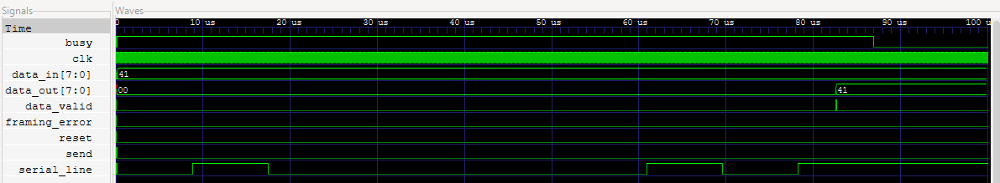
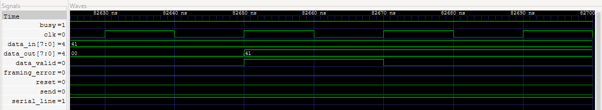

# fpga-uart
A UART (Universal Asynchronous Receiver/Transmitter) implementation written in SystemVerilog, with Python/cocotb testbenches and automated GitHub Actions testing.

The project includes separate transmitter (TX) and receiver (RX) modules, plus a loopback wrapper that connects them together. Development and verification use simulation; physical FPGA hardware is not required.

## Project Objectives
- Design UART transmitter and receiver modules in SystemVerilog.
- Implement finite-state machines (FSMs), baud-rate timing, and serial data handling.
- Develop Python-based testbenches to generate test sequences and verify transmitted and received data.
- Validate functionality through simulation, waveform analysis, and automated testing.
- Integrate GitHub Actions for continuous integration (CI).

## Technical Specifications
| Parameter | Initial Configuration |
|---|---|
| Hardware Description Language | SystemVerilog |
| Data Bits | 8 |
| Parity | None |
| Stop Bits | 1 |
| Bit Order | Least significant bit first |
| Clock Frequency | 50 MHz in the testbenches |
| Clocks per Bit | 434 by default |
| Baud Rate | Approximately 115,207 bps, targeting 115200 |
| Reset | Active-high, synchronous |
| Hardware Target | Simulation-first, FPGA-oriented |

## Repository Structure
| File | Purpose |
|---|---|
| `rtl/uart_tx.sv` | UART transmitter |
| `rtl/uart_rx.sv` | UART receiver |
| `rtl/uart_loopback.sv` | Connects TX directly to RX |
| `tests/test_uart_tx.py` | Independent transmitter tests |
| `tests/test_uart_rx.py` | Independent receiver tests |
| `tests/test_uart_loopback.py` | Tests TX and RX together |
| `Makefile` | Selects and runs simulation targets |
| `.github/workflows/uart-tests.yml` | Runs all three targets in GitHub Actions |

## Development Tools
| Tool | Purpose |
|---|---|
| Icarus Verilog | SystemVerilog simulation through cocotb |
| Python/cocotb | Test generation and automated verification |
| GNU Make | Build and run simulations |
| MSYS2 UCRT64 | Local Windows development environment |
| GitHub Actions | Automated testing on pushes and pull requests |
| GTKWave | Digital waveform visualization |

## Verification Plan
The UART implementation will be tested against a variety of input sequences and operating conditions.

| Test | Description |
## Waveform Inspection

Generate a waveform for the ASCII `A` loopback test:

```bash
make TARGET=uart_loopback WAVES=1 COCOTB_TEST_FILTER=loopback_ascii_a
```

Open the generated waveform in GTKWave:

```bash
gtkwave sim_build_uart_loopback/uart_loopback.fst
```

Waveform inspection confirmed:
- The frame contains a low start bit, eight data bits sent LSB first, and a high stop bit.
- Transmitted and received data match ASCII `A` (`0x41`).
- Each bit lasts 8.68 μs (434 clock cycles at 50 MHz).
- `busy` returns low after transmission.
- `data_valid` pulses for one clock cycle (20 ns).
- `framing_error` remains low.

### ASCII A Loopback Frame



### Receive Data Valid Pulse



|---|---|
| Basic Transmission | Verify transmission and reception of `0x41` (ASCII 'A'). |
| Full Byte Range | Test all 256 possible 8-bit values (`0x00`–`0xFF`). |
| Alternating Bits | Test `0x55` and `0xAA` to verify bit ordering and transitions. |
| Randomized Traffic | Test 10,000 reproducibly generated random bytes. |
| Baud Rate Tolerance | Evaluate receiver behavior under baud-rate mismatch. |
| Framing Errors | Verify detection of invalid stop bits. |
| Continuous Transmission | Test consecutive frames without additional idle time. |
| Parity Errors | Verify parity checking if parity support is implemented. |

## Current Scope
The implementation supports 8N1 UART communication: eight data bits, no parity, and one stop bit.

Parity checking, transmit/receive queues, and physical FPGA validation are outside the current implementation. Automated tests verify digital simulation behavior; they do not model real electrical noise or metastability.

## References
- [OpenTitan UART Documentation](https://opentitan.org/book/hw/ip/uart/) — UART hardware design, features, and operation.
- [OpenTitan UART Verification Plan](https://github.com/lowRISC/opentitan/blob/master/hw/ip/uart/data/uart_testplan.hjson) — UART test scenarios and verification goals.
- [Nandland UART Tutorial](https://nandland.com/uart-serial-port-module/) — Explanation and HDL examples of UART transmitters and receivers.
- [Verilator Documentation](https://verilator.org/guide/latest/) — Guide to compiling, simulating, and checking Verilog/SystemVerilog designs.
- [cocotb Documentation](https://docs.cocotb.org/en/stable/) — Write Python testbenches to verify HDL designs.
- [MSYS2 Documentation](https://www.msys2.org/) — Set up a development environment and install tools on Windows.
- [Icarus Verilog Documentation](https://steveicarus.github.io/iverilog/) — Compile and simulate Verilog/SystemVerilog designs.
- [GTKWave](https://gtkwave.sourceforge.net/) — View simulation waveforms to inspect UART timing, signals, and internal states.
- [Understanding GitHub Actions](https://docs.github.com/en/actions/get-started/understand-github-actions) — Overview of workflows, jobs, runners, and steps.
- [GitHub Actions Workflow Syntax](https://docs.github.com/en/actions/reference/workflows-and-actions/workflow-syntax) — Reference for writing workflow YAML files.
- [actions/checkout](https://github.com/actions/checkout) — Make repository files available to the workflow.
- [actions/setup-python](https://github.com/actions/setup-python) — Configure Python for automated tests.